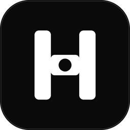
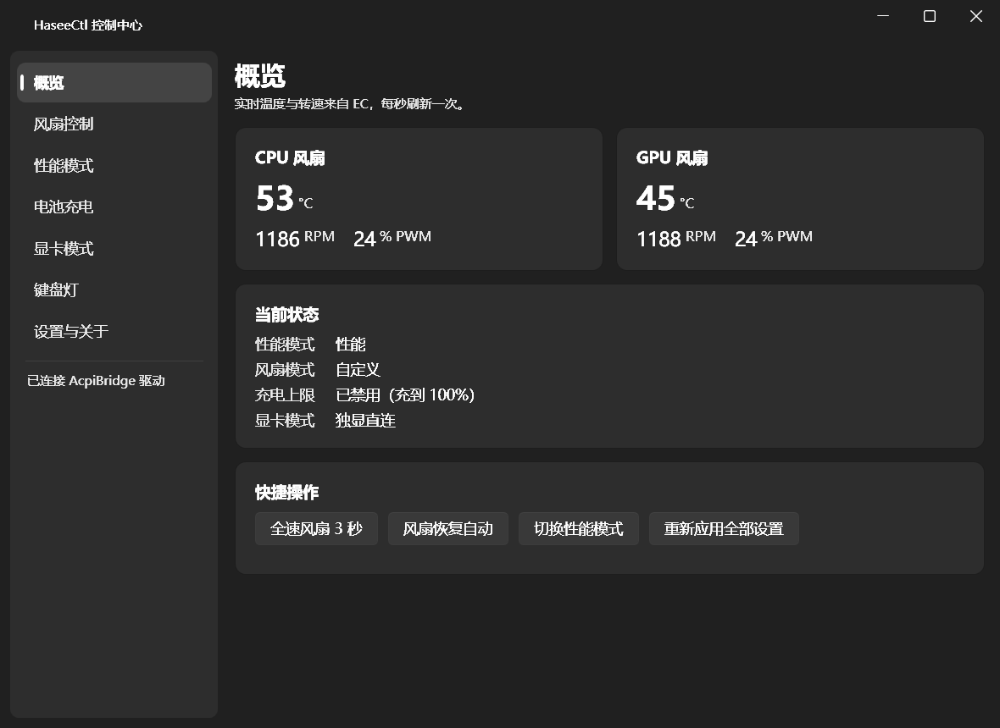
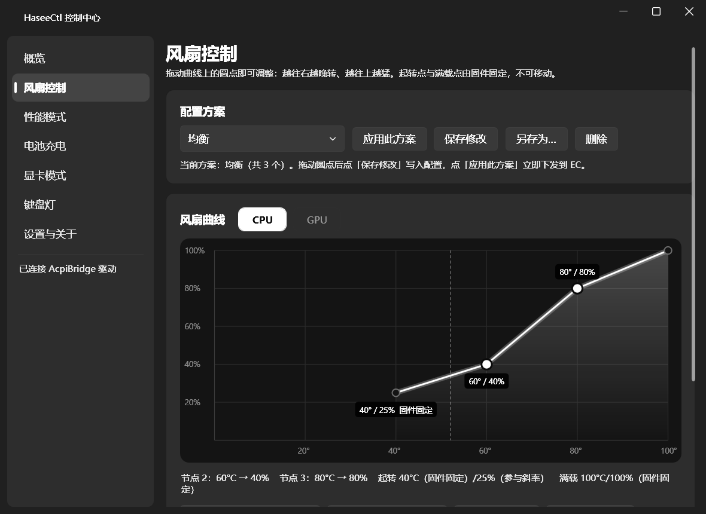
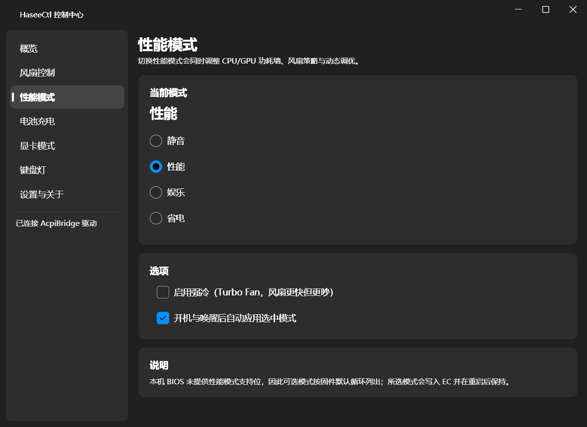
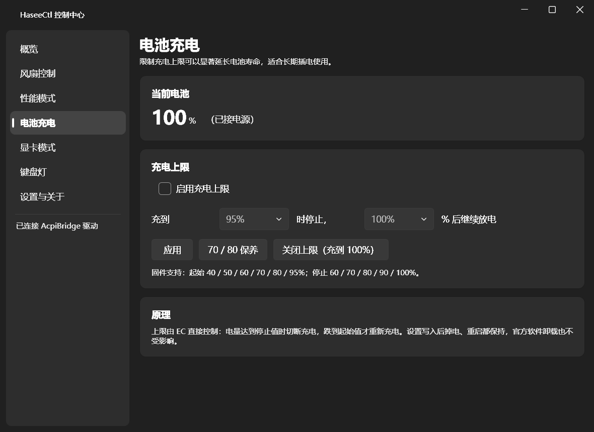
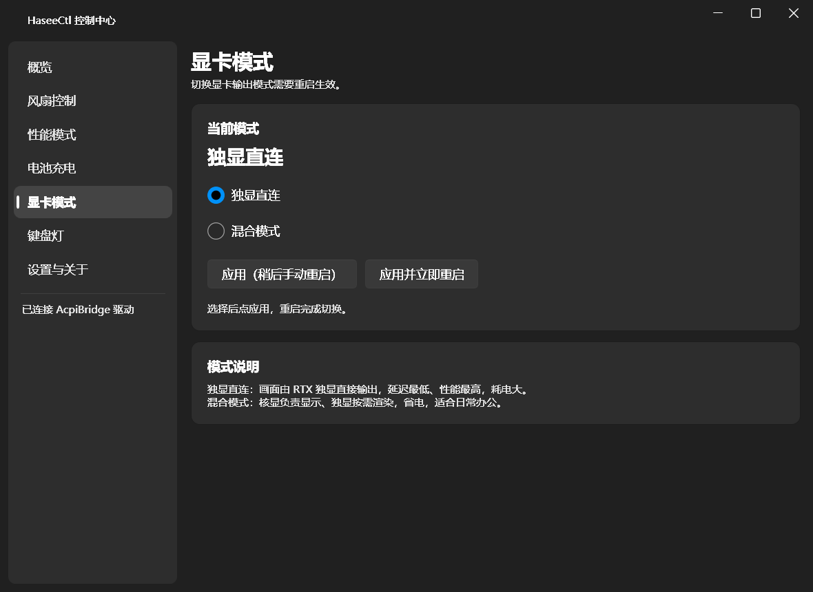
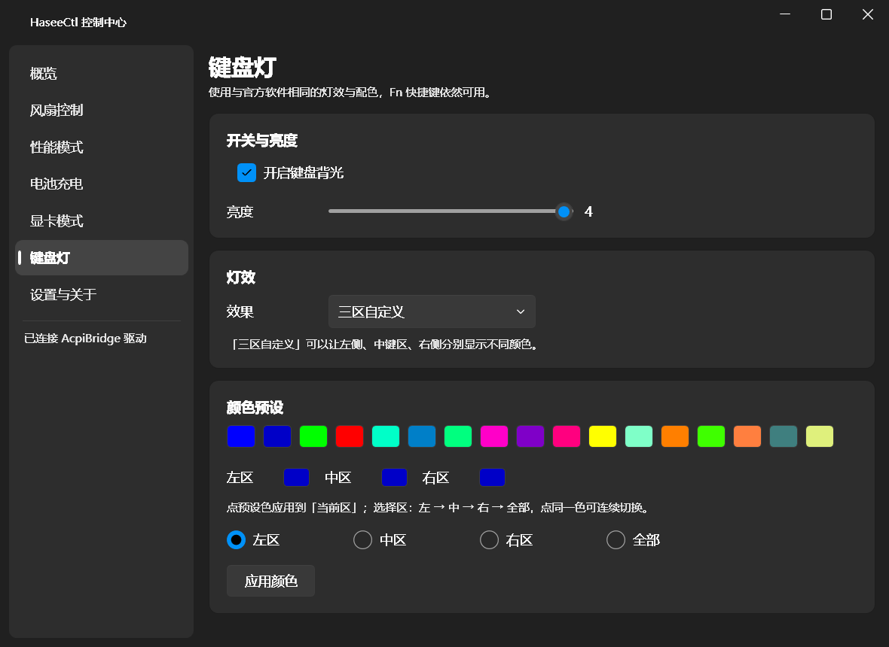
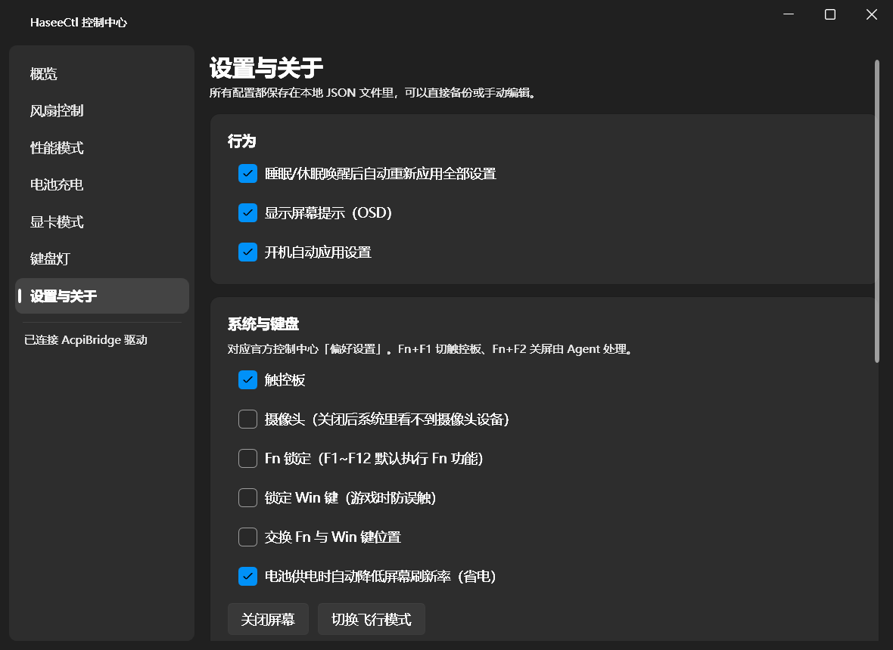

<div align="center">


# HaseeCtl

神舟战神 Z8D6 / CV15S（蓝天 Clevo 模具）的轻量控制中心，替代官方 Control Center

官方那套 444 MB，这个 34 MB。常驻内存从 76 MB 降到 17 MB

[](https://github.com/SSRYLJRSS/HaseeCtl/releases)
[](LICENSE)
[]()
[]()

[下载](#下载) · [界面](#界面) · [快速上手](#快速上手) · [关于 DLL](#关于-insydeairplanemodehiddll) · [开发](#开发)
</div>

---

用 C# 直接和 EC（嵌入式控制器）对话，中间只借道官方驱动包里的 **AcpiBridge**，不经过任何官方用户态程序。官方的 `CC40.exe`、`FnKey.exe` 这些全都可以不跑。

## 功能

- **风扇**：拖拽式 CPU/GPU 四节点曲线，多套方案并存。自动 / 静音 / 全速 / 慢速四档，睡眠唤醒和重启后自动重新下发。
- **性能模式**：省电 / 安静 / 性能 / 娱乐，写入 EC 后重启仍保持。可选开机与唤醒后自动应用。
- **电池充电上限**：FlexiCharger 区间限充，起始 40~95%、停止 60~100%。由 EC 直接执行，断电、重启、卸载本软件都不影响，想关就关。
- **显卡模式**：独显直连 / 混合，一键应用并可立即重启生效。
- **键盘灯**：亮度四档、17 色预设，支持左中右三区分别着色。
- **系统开关**：触控板、摄像头、Fn 锁、Win 键锁、Fn/Win 互换、电池供电降刷新率、飞行模式、关闭屏幕。
- **托盘 Agent**：常驻后台接管 Fn 热键（Fn+F1 触控板、Fn+F2 关屏、性能键、风扇键、灯光键）并弹出屏幕提示。**官方服务全停也能用**。

不包含：自定义键盘宏。

## 界面

<p align="center"></p>
<p align="center"><sub>概览 · 温度、转速、PWM 每秒刷新，四项快捷操作一键触发</sub></p>

<p align="center"></p>
<p align="center"><sub>风扇控制 · 拖曲线上的圆点即改曲线，松手保存，应用到 EC 立即生效</sub></p>

<p align="center"></p>
<p align="center"><sub>性能模式 · 四档可选，启用强冷换更快风扇，可设开机与唤醒自动应用</sub></p>

<p align="center"></p>
<p align="center"><sub>电池充电 · 上限由 EC 执行，卸载软件也不丢失；「关闭上限」可随时恢复满充</sub></p>

<p align="center"></p>
<p align="center"><sub>显卡模式 · 独显直连 / 混合切换，可延后手动重启</sub></p>

<p align="center"></p>
<p align="center"><sub>键盘灯 · 17 色预设 + 三区独立着色，Fn 灯光键依然可用</sub></p>

<p align="center"></p>
<p align="center"><sub>设置与关于 · 唤醒重应用、OSD、开机应用，以及触控板 / 摄像头 / Fn 锁 / 飞行等系统开关</sub></p>

## 下载

| 系统与架构 | 安装包 |
| --- | --- |
| Windows 10 / 11 x64 | [HaseeCtl-v1.0.0-win-x64.zip](https://github.com/SSRYLJRSS/HaseeCtl/releases/download/v1.0.0/HaseeCtl-v1.0.0-win-x64.zip) |

需要 [.NET 10 桌面运行时（x64）](https://dotnet.microsoft.com/download/dotnet/10.0)。

## 快速上手

1. 下载 release 里的 zip，解压到任意目录。**不要放 `C:\Program Files`**——安装脚本会把它当程序目录，Program Files 的权限会让自带更新和配置写入出问题。
2. 右键 `安装.cmd` → 以管理员身份运行。它会装进 `%LOCALAPPDATA%\Programs\HaseeCtl`，建开始菜单项和开机自启，并立刻拉起托盘 Agent。
3. 双击开始菜单里的 **HaseeCtl 控制中心**，或者点托盘图标打开主界面。
4. 按需调整。所有设置落地即生效，风扇和性能模式会写进 EC，重启后照旧。
5. 卸载：开始菜单 → **卸载 HaseeCtl**，或者跑 `%LOCALAPPDATA%\Programs\HaseeCtl\卸载.cmd`。会先恢复风扇自动、性能模式、关灯、清掉充电上限，再删文件。

装完之后，官方 Control Center **主程序**可以放心卸。但请注意区别：

- **可以卸**：`CC40.exe`、`FnKey.exe` 这些官方用户态程序，以及 `ControlCenter` 目录下的主程序文件。
- **不能卸**：`AcpiBridge` 驱动（设备管理器里的 `ACPI\CLV0001`）和 `HKKbdFltr.sys` 键盘过滤驱动。前者是本项目访问 EC 的唯一通道，后者是 Fn 按键事件的唯一来源。卸了它们，本软件也一起失效。
- **建议停用**：`CCDCHUService` 和 `HKClipSvc` 两个服务。把启动类型改成「禁用」后，Fn 热键会自动切换到驱动通知通道，实测照常工作。这就是官方软件「休眠但没删」的状态，方便随时回退。

## 关于 InsydeAirplanemodehid.dll

`InsydeAirplanemodehid.dll` 是**自带**的——release 压缩包里就有，安装脚本会一并装进程序目录。你不需要去官方目录翻文件，也不用自己往 `native\` 里拷。

只有飞行模式开关用到它。**缺了它，其余所有功能都正常**，只是「切换飞行模式」按钮会报错，本项目会捕获异常并提示，不会崩。

需要说明的是：这个 DLL 属于 **Insyde**，是从官方驱动包里提取后重新打包的构建产物，**版权仍归原厂所有**，不在本项目的 MIT 许可证覆盖范围内。这里只做分发以方便使用，不主张任何权利。如果你所在地区对再分发有顾虑，可以自行从已安装的官方程序中取用，或直接删除该文件——除飞行模式外功能不受影响。

本项目源码仓库的 `.gitignore` 排除了 `native/*.dll`，所以 **clone 源码不会拿到这个 DLL**，自己编译时需要从官方装好的目录里取一份放到 `native\`。走 release 安装包则无需操心。

## 开发

**技术栈**：.NET 10 / WPF / [Wpf.Ui](https://github.com/lepoco/wpfui) / WinRT / P/Invoke

```powershell
git clone https://github.com/SSRYLJRSS/HaseeCtl.git
cd HaseeCtl

# 从官方目录取一份 DLL 放到 native\ （仅飞行模式需要）
.\build.ps1                 # Release 构建并打包到 dist\HaseeCtl
.\dist\HaseeCtl\安装.cmd    # 管理员运行
```

驱动通道自检（不需要跑主界面，用来确认驱动和 Fn 通道是否正常）：

```powershell
cd tools\HaseeCtl.Probe
dotnet run -c Release -- --driverkeys 15    # 监听 15 秒驱动热键通道，然后按几个 Fn 组合键
```

> 若官方 `CCDCHUService` 仍在运行，事件被它独占，这里会收到 0 个键码，属正常现象。

| 目录 | 内容 |
| --- | --- |
| `src/HaseeCtl.Core` | 驱动通信（`AcpiBridge`）、各功能服务、配置持久化 |
| `src/HaseeCtl.App` | WPF 主界面，七个页面 |
| `src/HaseeCtl.Agent` | 托盘常驻、Fn 热键、OSD、唤醒后重新应用 |
| `tools/HaseeCtl.Probe` | 硬件读数与自检命令行 |
| `installer` | 安装 / 卸载 PowerShell 脚本 |
| `native` | 放置 `InsydeAirplanemodehid.dll`（不入库） |
| `docs` | 使用说明、规划书、界面截图 |

## 兼容性

主目标机型 **神舟战神 Z8D6**（认证型号 **CV15S**，蓝天 Clevo 模具，i7-12650H + RTX 4060 Laptop）。

依赖以下几项硬件特征，其他型号请先核对再试：

- ACPI 设备 `ACPI\CLV0001`，且 `AcpiBridge` 驱动版本 1.0.0.7（Insyde）
- `HKKbdFltr.sys` 键盘类过滤驱动存在且已注册（Fn 事件唯一入口）
- EC 区域布局与本机型一致（`App(1,12)`、`App(4,5)` 等）

**仅在 CV15S 上实测。** 同模具的蓝天机型大概率可用，但本项目直接写 EC，写错寄存器有风险，其他型号使用请自担。

## 反馈与贡献

遇到问题请到 [Issues](https://github.com/SSRYLJRSS/HaseeCtl/issues) 反馈，附上机型、BIOS 版本和日志（`%LOCALAPPDATA%\HaseeCtl\logs\`）。欢迎 PR。

## 许可证

代码以 [MIT](LICENSE) 发布。`InsydeAirplanemodehid.dll` 版权归 Insyde 所有，不在本许可证覆盖范围内。
