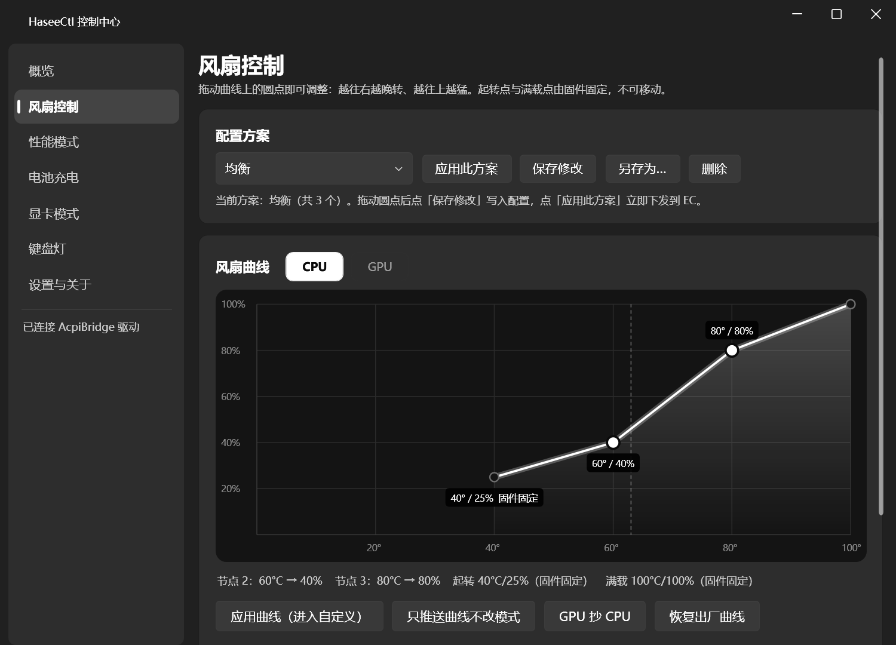

# HaseeCtl

神舟 CV15S（蓝天 Clevo 模具）控制中心的轻量替代实现。直接通过官方 AcpiBridge 驱动与 EC 通信，不依赖官方 Control Center。



## 功能

- 风扇：拖拽式 CPU/GPU 曲线、多方案、自动/静音/全速/慢速，设置重启和睡眠唤醒后自动重新应用
- 性能模式：省电 / 安静 / 性能 / 娱乐
- 电池充电上限（FlexiCharger）
- 显卡模式：独显直连 / 混合
- 键盘灯：亮度、三区颜色
- 系统：触控板、摄像头、Fn 锁、Win 键锁、Fn/Win 互换、电池供电低刷新率、飞行模式、关闭屏幕
- 托盘 Agent：Fn 热键（Fn+F1 触控板、Fn+F2 关屏、性能/风扇键等）和屏幕提示

不包含：自定义键盘宏。

## 前提

- 机器已安装官方驱动包（AcpiBridge 驱动和 CCDCHUService 服务）。**不要卸载驱动包**，只有官方控制中心主程序可以卸载。
- .NET 10 桌面运行时（x64）。

## 构建

需要 .NET 10 SDK。

```powershell
.\build.ps1          # 输出到 dist\HaseeCtl
.\dist\HaseeCtl\安装.cmd
```

飞行模式切换依赖厂商的 `InsydeAirplanemodehid.dll`（x64），仓库不附带。请从官方 Fn 热键程序目录复制到 `native\`，缺少时其他功能不受影响。

## 目录

| 目录 | 内容 |
| --- | --- |
| `src/HaseeCtl.Core` | 驱动通信、各功能服务、配置 |
| `src/HaseeCtl.App` | WPF 主界面 |
| `src/HaseeCtl.Agent` | 托盘常驻、热键、唤醒后重新应用 |
| `tools/HaseeCtl.Probe` | 硬件读数和自检命令行 |
| `installer` | 安装/卸载脚本 |
| `docs` | 使用说明、规划书 |

## 免责声明

本项目通过逆向官方软件得到的接口直接写 EC，仅在 CV15S 上测试。其他型号使用风险自负。
